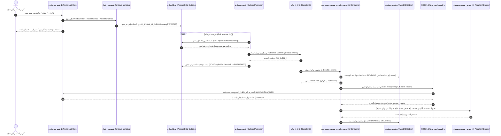
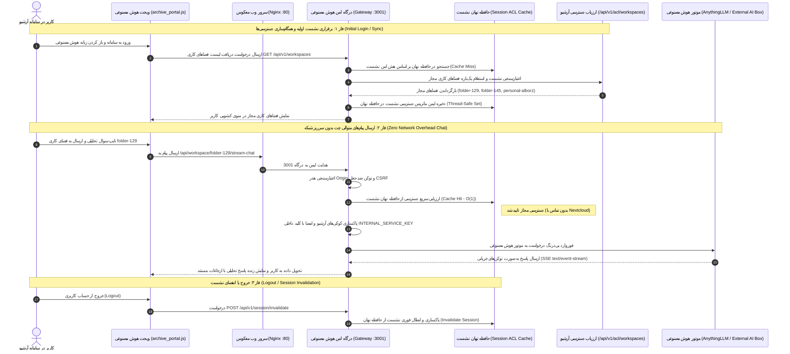

# سند جامع معماری، راهنمای بهره‌برداری و تحویل فنی پروژه
## یکپارچه‌سازی سامانه آرشیو اسناد سازمانی (Enterprise Archive) و جعبه هوش مصنوعی (AI Box)

**نسخه سند:** ۱.۰ (تولید نهایی و آماده تحویل به تیم مهندسی)  
**تاریخ نگارش:** ۲۶ اکتبر ۲۰۲۶ (۵ آبان ۱۴۰۵)  
**مخاطب:** تیم توسعه، پشتیبانی و نگهداری نرم‌افزار / تیم هوش مصنوعی  
**وضعیت:** مصوب، پیاده‌سازی‌شده، راستی‌آزمایی‌شده در آزمون‌های E2E و آماده تحویل رسمی  

---

## ۱. نمای کلی مدیریتی و معماری تفکیک‌شده سه لایه (Executive Overview)

اکوسیستم یکپارچه از سه سیستم مستقل، ناهمگام و کاملاً ایزوله تشکیل شده است که هیچ‌کدام وابستگی چسبنده یا تزریق مستقیم به کد یا پایگاه داده دیگری ندارند:

```
+---------------------------------------------------------------------------------------------------+
|                                1. ENTERPRISE ARCHIVE SYSTEM (SOR)                                 |
|                               (مسیر: /home/alborz/enterprise-archive-system)                      |
|                                                                                                   |
|  - مرجع رسمی و انحصاری اسناد، متادیتا و کنترل دسترسی (System of Record)                           |
|  - هسته بومی Nextcloud Hub با نرم‌افزار سازمانی سفارشی archive_autotag                             |
|  - شنوندگان رخداد چرخه حیات (NodeWrittenListener, NodeDeletedListener, NodeRenamedListener)       |
|  - ثبت تضمینی رویداد در پایگاه داده PostgreSQL بر پایه الگوی Transactional Outbox                 |
|  - احراز هویت نشست کاربری و کنترل پویای دسترسی پوشه‌محور (Dynamic Folder-Centric ACL)             |
+---------------------------------------------------------------------------------------------------+
                                                │
                                    (HTTP/REST Internal API)
                                                ▼
+---------------------------------------------------------------------------------------------------+
|                                    2. INTEGRATION LAYER (BRIDGE)                                  |
|                                   (مسیر: /home/alborz/integration-layer)                          |
|                                                                                                   |
|  - پل ارتباطی سبک، مستقل و بدون دیسک میان سامانه آرشیو و پیام‌رسان هوش مصنوعی                      |
|  - سرویس Outbox Publisher: استعلام دوره‌ای، انتشار در صف با Publisher Confirm و ارسال تأییدیه ACK |
|  - سرویس Streaming File Proxy (پورت 8090): واکشی و تحویل بایت‌به‌بایت فایل با مصرف ثابت O(1) RAM  |
|  - کارگزار پیام پایدار RabbitMQ (Exchange: archive.events, Routing Key: file.created)             |
+---------------------------------------------------------------------------------------------------+
                                                │
                                          (AMQP Events)
                                                ▼
+---------------------------------------------------------------------------------------------------+
|                                       3. AI BOX (SOI)                                             |
|                                     (مسیر: /home/alborz/ai-box)                                   |
|                                                                                                   |
|  - موتور مستقل برداری‌سازی، نمایه‌سازی و پردازش معنایی اسناد (System of Intelligence)              |
|  - کانسومر رویدادها (ai-box-consumer) و مدیریت وضعیت در دیتابیس محلی Task DB (SQLite)            |
|  - درگاه امن AI Box Gateway (پورت 3001): اعتبارسنجی نشست آرشیو، ممیزی دسترسی و هدایت چت          |
|  - آداپتور ماژولار تعویض‌پذیر (Plug-and-Play Engine Adapter):                                     |
|      * شبیه‌ساز توسعه و آزمون: AnythingLLM + LanceDB + Ollama                                      |
|      * سرویس عملیاتی بیرونی: External AI Box Appliance (بدون نیاز به بازنویسی کد)                |
+---------------------------------------------------------------------------------------------------+
```

### اصول حاکم بر این معماری:
1. **استقلال مطلق آپلود کاربر از هوش مصنوعی:** فرآیند ذخیره فایل در آرشیو و اعلام پایان موفق آپلود به کاربر، هرگز منتظر پردازش مدل زبانی، در دسترس بودن RabbitMQ یا وضعیت کانتینرهای AI نمی‌ماند.
2. **الگوی Transactional Outbox:** تمامی تغییرات فایل‌ها در همان تراکنش بانک اطلاعاتی در جدول `oc_archive_ai_outbox` ذخیره می‌شوند؛ بنابراین هیچ رخدادی در اثر خاموشی یا خطای شبکه گم نمی‌شود.
3. **انتقال بدون دیسک و امن فایل‌ها (Zero-Disk In-Memory Streaming):** فایل‌ها از طریق اندپوینت رمزنگاری‌شده پراکسی (`:8090/files/{id}`) به صورت تکه‌های ۶۴ کیلوبایتی مستقیماً به رم موتور هوش مصنوعی استریم می‌شوند و هیچ ردپایی روی هارددیسک لایه میانی باقی نمی‌گذارند.
4. **تکرارپذیری و مقاومت در برابر خرابی (Fault Tolerance):** هر پیام در صف پیام تا زمانی که در پایگاه داده وظایف AI Box (`ai_box_tasks.db`) ثبت نشود ACK نمی‌شود، و تا زمانی که وضعیت برداری شدن در وکتور دیتابیس تأیید نشود وظیفه به پایان نمی‌رسد.

---

## ۲. نمودارهای جامع جریان داده و فرآیندها (Mermaid Diagrams)

### دیاگرام ۱: خط لوله رویدادمحور جذب، حذف و تغییر اسناد (Ingestion / Deletion / Move Pipeline)



---

### دیاگرام ۲: خط لوله چت برخط با معماری کش و همگام‌سازی مبتنی بر نشست (Session-based ACL Caching Pipeline)



---

## ۳. مدل کنترل دسترسی پویای پوشه‌محور (Dynamic Folder-Centric ACL Model)

یکی از تحولات کلیدی این نسخه، حذف کامل فایل‌های نگاشت استاتیک (`gid_workspace_map.json`) و جایگزینی آن با **مدل پویای کنترل دسترسی مبتنی بر ساختار پوشه‌های سازمانی** است.

### ساختار نام‌گذاری فضاهای کاری (Workspace Slugs)
1. **فضاهای کاری پوشه‌های سازمانی (`folder-{fileid}`):**  
   - هر پوشه اصلی درون شاخه `Enterprise_Archive` یا هر پوشه دارای اشتراک سازمانی، بر اساس شناسه یکتای عددی آن در جدول `filecache` شناسایی می‌شود.
   - مثال: پوشه «امور مالی» با شناسه عددی ۱۲۹ دارای اسلاگ `folder-129` است.
   - مزیت: عدم وابستگی به زبان (فارسی/انگلیسی)، جلوگیری از تداخل نام‌ها و پایداری در تغییر نام پوشه.
2. **فضای کاری شخصی کاربر (`personal-{uid}`):**  
   - هر کاربر یک فضای کاملاً ایزوله برای یادداشت‌ها و اسناد خصوصی خود دارد.
   - مثال: کاربر `alborz` به فضای `personal-alborz` دسترسی دارد. هیچ کاربر دیگری مجاز به دیدن یا چت در این فضا نیست.

### معماری کش و همگام‌سازی سطوح دسترسی مبتنی بر نشست (Session-based ACL Caching & Synchronization)

جهت حل نهایی هرگونه عدم انطباق احتمالی میان مجوزهای فایلی Nextcloud و فضاهای کاری هوش مصنوعی و به موازات آن، **ریشه‌کن کردن کامل سرریزهای شبکه ناشی از استعلام مکرر مجوزها در هر پیام چت (Per-Request Overhead)**، معماری کشینگ مبتنی بر نشست کاربر در `ai_box_gateway` پیاده‌سازی شده است:

#### ۱. چرخه حیات نشست و مجوزها (Session ACL Lifecycle):
* **واکشی در زمان برقراری نشست (Fetch on Login / Initial Session):** هنگامی که کاربر وارد سامانه شده و برای نخستین بار با درگاه ارتباط برقرار می‌کند (مثلاً در فراخوانی اولیه `GET /api/v1/workspaces` جهت چیدن منوی چت)، درگاه نشست را با OCS آرشیو اعتبارسنجی کرده و نقشه دسترسی به پوشه‌ها را یک‌بار از اندپوینت `/api/v1/acl/workspaces` دریافت می‌کند.
* **ذخیره‌سازی ایمن در حافظه نهان (In-Memory Session Cache):** این نقشه دسترسی به همراه شناسه کاربر، گروه‌ها و اسلاگ‌های مجاز (`allowed_slugs`) در یک ساختار حافظه‌ای امن (`SessionACLCache`) با کلید هش‌شده توکن نشست نگهداری می‌شود.
* **اعتماد به کش در طول نشست فعال (Zero Network Overhead):** در تمامی درخواست‌های بعدی چت و استریمینگ چت (`/stream-chat`)، مجوزها مستقیماً با پیچیدگی زمانی $O(1)$ از حافظه نهان ارزیابی می‌شوند و هیچ‌گونه تماس شبکه‌ای تکراری با Nextcloud برقرار نمی‌گردد.
* **ابطال قطعی در زمان خروج (Invalidate on Logout):** با خروج کاربر از سامانه یا فراخوانی اندپوینت `/api/v1/session/invalidate`، رکورد نشست بلافاصله از حافظه نهان پاکسازی شده و هرگونه تلاش با توکن منقضی یا باطل‌شده با خطای `401 Unauthorized` مسدود می‌گردد.

#### ۲. مزایای امنیتی و بهینه‌سازی عملکردی:
1. **حذف تاخیر شبکه:** حذف کامل زمان تاخیر ۲۰۰ تا ۵۰۰ میلی‌ثانیه‌ای استعلام مکرر مجوز در هر توکن یا تبادل چت.
2. **عدم افشای اطلاعات هویتی در حافظه نهان:** کلیدهای کش با الگوریتم رمزنگاری `SHA-256` از روی کوکی‌ها هش می‌شوند تا هیچ کوکی خام یا رمز عبور نشستی در حافظه باقی نماند.
3. **همزمانی امن و ایمنی چندنخی (Thread-Safety):** تمامی عملیات خواندن، نوشتن و انقضای نشست توسط قفل بازگشتی سراسری (`threading.RLock`) در برابر شرایط رقابتی (Race Conditions) محافظت شده است.
4. **تاب‌آوری و تنزل ایمن (Graceful Fallback):** در شرایط بروز خطای موقت در اتصال به آرشیو، درگاه با سازوکار امن پیش‌فرض (تطابق گروه‌های احراز هویت‌شده با نقشه‌های سازمانی و فضای شخصی `user-{uid}`) پاسخ داده و از قطعی سرویس جلوگیری می‌کند.

### نحوه عملکرد تفکیک دسترسی در زمان واقعی:
- هنگامی که کاربر وارد سامانه می‌شود، درگاه هوش مصنوعی اندپوینت `/api/v1/acl/workspaces` را با کوکی نشست کاربر صدا می‌زند.
- کنترل‌کننده آرشیو (`AiOutboxApiController`) از طریق `CentralPermissionResolver` ماتریس دسترسی کاربر به تک‌تک پوشه‌ها را با توجه به نقش‌های کاربری، عضویت در گروه‌ها و اشتراک‌های فعال ارزیابی کرده و لیست فضاهای مجاز را تولید می‌کند.
- اگر دسترسی کاربری به یک دپارتمان سلب شود، این تغییر در لحظه بعدی در منوی چت هوش مصنوعی منعکس می‌شود و حتی در صورت ارسال مستقیم درخواست، با خطای `403 Forbidden` مسدود خواهد شد.

---

## ۴. ساختار جداول پایگاه داده (Database Schemas)

### ۱. جدول پایدار Outbox در PostgreSQL آرشیو (`oc_archive_ai_outbox`)
این جدول وظیفه ثبت رخدادهای سامانه آرشیو را برای تحویل ناهمگام به هوش مصنوعی دارد:

| ستون (Column) | نوع داده (Data Type) | توضیحات |
| :--- | :--- | :--- |
| `id` | `BIGSERIAL PRIMARY KEY` | شناسه یکتای ترتیبی رکورد |
| `event_id` | `VARCHAR(64) UNIQUE` | شناسه رخداد UUIDv4 (جهت تکرارزدایی قطعی) |
| `event_type` | `VARCHAR(32)` | نوع رخداد: `file.created`، `file.deleted`، `file.moved` |
| `file_id` | `BIGINT NOT NULL` | شناسه فایل در جدول Nextcloud filecache |
| `file_path` | `VARCHAR(4000) NOT NULL` | مسیر کامل فایل در ساختار ذخیره‌سازی آرشیو |
| `file_name` | `VARCHAR(255) NOT NULL` | نام فایل به همراه پسوند |
| `owner_uid` | `VARCHAR(64) NOT NULL` | شناسه کاربری بارگذاریکننده فایل |
| `group_name` | `VARCHAR(64)` | گروه یا دپارتمان حاکم بر سند |
| `mime_type` | `VARCHAR(128) NOT NULL` | نوع داده (MIME type مانند text/plain) |
| `file_size` | `BIGINT NOT NULL` | حجم دقیق فایل بر حسب بایت |
| `sha256_hash` | `VARCHAR(64) NOT NULL` | هش محتوای فایل جهت اعتبارسنجی اصالت |
| `status` | `VARCHAR(16) NOT NULL` | وضعیت رخداد: `PENDING`، `PUBLISHED`، `FAILED` |
| `retry_count` | `INTEGER DEFAULT 0` | تعداد دفعات تلاش ناموفق برای ارسال به صف |
| `last_error` | `TEXT` | متن آخرین خطای رخ‌داده در ارسال |
| `scope` | `VARCHAR(32) NOT NULL` | حوزه سند: `folder` (سازمانی) یا `personal` (شخصی) |
| `workspace_slug` | `VARCHAR(128) NOT NULL` | شناسه فضای کاری مقصد (`folder-{id}` یا `personal-{uid}`) |
| `workspace_name` | `VARCHAR(255) NOT NULL` | نام نمایشی فضا برای کاربر |
| `old_workspace_slug`| `VARCHAR(128)` | شناسه فضای قبلی در رخدادهای جابجایی (`file.moved`) |
| `created_at` | `TIMESTAMP NOT NULL` | زمان ثبت اولیه رخداد در پایگاه داده |
| `published_at` | `TIMESTAMP` | زمان انتشار موفقیت‌آمیز در RabbitMQ و دریافت تاییدیه |

---

### ۲. جدول ممیزی دسترسی به اسناد در PostgreSQL آرشیو (`oc_archive_ai_audit`)
این جدول هرگونه واکشی و استریم فایل توسط هوش مصنوعی را به صورت غیرقابل انکار ثبت می‌کند:

| ستون (Column) | نوع داده (Data Type) | توضیحات |
| :--- | :--- | :--- |
| `id` | `BIGSERIAL PRIMARY KEY` | شناسه ترتیبی ممیزی |
| `request_id` | `VARCHAR(64)` | شناسه رهگیری درخواست (X-Request-ID) |
| `actor_uid` | `VARCHAR(64)` | شناسه کاربر درخواست‌دهنده اصلی |
| `service_id` | `VARCHAR(64)` | شناسه سرویس ماشین استعلام‌کننده |
| `token_id` | `VARCHAR(64)` | شناسه کلید امنیتی استفاده‌شده |
| `file_id` | `BIGINT NOT NULL` | شناسه فایلی که استریم شده است |
| `file_name` | `VARCHAR(255)` | نام فایل استریم‌شده |
| `auth_type` | `VARCHAR(32)` | شیوه احراز هویت (Bearer Token) |
| `result` | `VARCHAR(32)` | نتیجه واکشی (`allowed` یا `denied`) |
| `client_ip` | `VARCHAR(64)` | آدرس IP مبدأ درخواست |
| `bytes_served` | `BIGINT` | تعداد بایت‌های منتقل‌شده |
| `duration_ms` | `BIGINT` | مدت‌زمان انتقال استریم به میلی‌ثانیه |
| `created_at` | `TIMESTAMP NOT NULL` | زمان انجام استریم |

---

### ۳. جدول مجوزهای اعطایی به فایل‌ها (`oc_archive_file_grants`)
مدل ذخیره‌سازی دسترسی‌های تفصیلی به هر سند:

| ستون (Column) | نوع داده (Data Type) | توضیحات |
| :--- | :--- | :--- |
| `id` | `BIGSERIAL PRIMARY KEY` | شناسه یکتای مجوز |
| `file_id` | `BIGINT NOT NULL` | شناسه فایل در آرشیو |
| `grantee_type` | `VARCHAR(16)` | نوع دریافت‌کننده: `user` یا `group` |
| `grantee_id` | `VARCHAR(64)` | نام کاربری یا شناسه گروه مجاز |
| `granted_by` | `VARCHAR(64)` | شناسه کاربری که دسترسی را اعطا کرده |
| `permissions` | `INTEGER` | ماسک ۸-بیتی سطح دسترسی (خواندن، نوشتن، حذف و ...) |
| `created_at` | `TIMESTAMP NOT NULL` | زمان اعطای دسترسی |

---

### ۴. جدول وظایف محلی هوش مصنوعی در SQLite (`ai_box_tasks.db -> tasks`)
این جدول مرجع اصلی وضعیت پردازش و برداری‌سازی در داخل سامانه AI Box است:

| ستون (Column) | نوع داده (Data Type) | توضیحات |
| :--- | :--- | :--- |
| `task_id` | `TEXT PRIMARY KEY` | شناسه یکتای وظیفه (UUIDv4) |
| `event_id` | `TEXT UNIQUE` | شناسه رخداد اصلی برگرفته از Outbox آرشیو |
| `event_type` | `TEXT` | نوع رخداد (`file.created`, `file.deleted`, ...) |
| `file_id` | `INTEGER` | شناسه فایل در آرشیو |
| `file_name` | `TEXT` | نام فایل |
| `file_size` | `INTEGER` | حجم فایل |
| `sha256_hash` | `TEXT` | هش محتوا برای اطمینان از عدم تغییر |
| `owner_uid` | `TEXT` | شناسه مالک فایل |
| `group_name` | `TEXT` | نام گروه یا دپارتمان |
| `target_workspace_slug`| `TEXT` | شناسه فضای کاری هدف در هوش مصنوعی |
| `status` | `TEXT` | وضعیت: `PENDING`, `DELIVERING`, `INDEXED`, `FAILED`, `SUPERSEDED` |
| `retry_count` | `INTEGER DEFAULT 0` | تعداد تلاش‌های مجدد در صورت خطا |
| `last_error` | `TEXT` | متن خطای پردازش در مدل هوش مصنوعی |
| `lease_owner` | `TEXT` | نام ورکر پردازش‌کننده فعال |
| `lease_expires_at` | `DATETIME` | انقضای زمان اختصاص وظیفه (مدیریت Crash Recovery) |
| `created_at` | `DATETIME` | زمان درج وظیفه |
| `updated_at` | `DATETIME` | آخرین زمان به‌روزرسانی وضعیت |

---

## ۵. راهنمای جامع عملیات و نگهداری سیستم (Operations & Runbook)

### ساختار کانتینرها و سرویس‌های فعال
کل اکوسیستم بر پایه **۷ کانتینر داکر** و **۲ سرویس لینوکسی systemd** اداره می‌شود:

| نام کانتینر / سرویس | لایه مربوطه | نقش عملیاتی | پورت‌های شبکه |
| :--- | :--- | :--- | :--- |
| `archive_proxy` | آرشیو | پراکسی معکوس Nginx برای وب و API آرشیو | `80`, `443` روی میزبان |
| `archive_app` | آرشیو | کانتینر اصلی Nextcloud + PHP-FPM + archive_autotag | داخلی داکر |
| `archive_db` | آرشیو | پایگاه داده پایدار PostgreSQL آرشیو | داخلی داکر |
| `ai_box_gateway` | هوش مصنوعی | درگاه احراز هویت و ممیزی چت هوش مصنوعی | `127.0.0.1:3001` روی میزبان |
| `ai_box_anythingllm` | هوش مصنوعی | سرور شبیه‌ساز رابط کاربری و LanceDB | داخلی داکر |
| `ai_box_ollama` | هوش مصنوعی | موتور استنتاج مدل‌های محلی زبانی و ایمبدینگ | داخلی داکر (11434) |
| `ai_box_rabbitmq` | هوش مصنوعی | کارگزار پیام صف رویدادها | `5672` (AMQP), `15672` (مدیریت) |
| `archive-integration-layer.service` | میانی | سرویس systemd ناشر Outbox و پراکسی استریم فایل | `8090` (پراکسی فایل) |
| `ai-box-consumer.service` | هوش مصنوعی | سرویس systemd دریافت پیام از RabbitMQ و ارسال به وکتور | پردازش پس‌زمینه |

---

### دستورات آغاز، توقف و بررسی سلامت

#### الف) مدیریت کانتینرهای آرشیو سازمانی:
```bash
cd /home/alborz/enterprise-archive-system

# راه‌اندازی کانتینرها:
docker compose up -d

# بررسی وضعیت سلامت:
docker compose ps

# مشاهده لاگ نرم‌افزار آرشیو:
docker compose logs -f app
```

#### ب) مدیریت کانتینرهای هوش مصنوعی:
```bash
cd /home/alborz/ai-box

# راه‌اندازی کانتینرها:
docker compose up -d

# مشاهده وضعیت و سلامت:
docker compose ps

# مشاهده لاگ درگاه گیت‌وی:
docker compose logs -f gateway
```

#### ج) مدیریت سرویس‌های لینوکسی پس‌زمینه (systemd):
```bash
# بررسی وضعیت سرویس‌ها:
sudo systemctl status archive-integration-layer.service
sudo systemctl status ai-box-consumer.service

# شروع یا راه‌اندازی مجدد:
sudo systemctl restart archive-integration-layer.service
sudo systemctl restart ai-box-consumer.service

# مشاهده لاگ‌های زنده سرویس میانی:
journalctl -u archive-integration-layer.service -f

# مشاهده لاگ‌های زنده سرویس مصرف‌کننده هوش مصنوعی:
journalctl -u ai-box-consumer.service -f
```

---

### راهنمای حل مسائل متداول (Troubleshooting Runbook)

#### ۱. خطای قطع دسترسی پایگاه داده PostgreSQL پس از Sleep سیستم (WSL Stale Mount)
* **علت:** در محیط‌های WSL ویندوز، پس از Sleep/Resume کامپیوتر ممکن است فایل سیستم اشتراکی دچار قطع هندل شود و خطای `relation "oc_appconfig" does not exist` در لاگ ظاهر گردد.
* **راه حل قطعی:** اجرای دستور زیر در مسیر آرشیو بلافاصله مانت‌های داکر را بدون از دست رفتن هیچ داده‌ای تجدید می‌کند:
  ```bash
  docker restart archive_db archive_app archive_proxy
  ```

#### ۲. مدیریت رویدادهای گیرکرده در وضعیت PENDING یا FAILED
* **علت:** خاموش بودن موقت RabbitMQ یا اختلال در شبکه داخلی.
* **بررسی:** با استعلام از دیتابیس وضعیت رکوردها را بررسی کنید:
  ```bash
  docker compose exec -T db psql -U nextcloud -d nextcloud -c \
    "SELECT id, event_id, status, retry_count, last_error FROM oc_archive_ai_outbox WHERE status != 'PUBLISHED';"
  ```
* **بازیابی:** سرویس `archive-integration-layer.service` به صورت خودکار هر رویداد شکست‌خورده با تعداد تکرار کمتر از سقف را مجدداً تلاش می‌کند. برای بازنشانی دستی رخدادها می‌توانید وضعیت آن‌ها را مجدداً به `PENDING` تغییر دهید:
  ```bash
  docker compose exec -T db psql -U nextcloud -d nextcloud -c \
    "UPDATE oc_archive_ai_outbox SET status = 'PENDING', retry_count = 0 WHERE status = 'FAILED';"
  ```

#### ۳. بررسی سلامت صف پیام در RabbitMQ
* می‌توانید از طریق خط فرمان وضعیت صف‌های رویداد را بررسی کنید:
  ```bash
  docker exec -it ai_box_rabbitmq rabbitmqctl list_queues name messages consumers
  ```
* خروجی باید وجود صف `ai_box.file_events` با حداقل یک مصرف‌کننده فعال (`consumers: 1`) را نشان دهد.

---

## ۶. نقشه راه و راهنمای توسعه‌دهندگان بعدی (Developer Continuation Guide)

این بخش راهنمای مستقیم تیم مهندسی بعدی است تا بدانند چگونه بدون دستکاری در کد هسته، کار را ادامه دهند.

### بخش الف: نحوه تعویض شبیه‌ساز با جعبه هوش مصنوعی واقعی (Production AI Box Swap)
در حال حاضر پشته AnythingLLM نقش شبیه‌ساز محلی را دارد. برای جایگزینی آن با جعبه هوش مصنوعی فیزیکی یا سرور واقعی تیم بیرونی:

1. **مستند مرجع قرارداد:** تمام نیازمندی‌های وب‌سرویس در مستند [AI_BOX_INTEGRATION_CONTRACT.md](file:///home/alborz/AI_BOX_INTEGRATION_CONTRACT.md) تدوین شده است.
2. **تغییر تنظیمات محیطی:** فایل `/home/alborz/ai-box/.env` را باز کرده و مقادیر زیر را تغییر دهید:
   ```ini
   # تغییر ارائه‌دهنده از anythingllm به سرور واقعی
   AI_BACKEND_PROVIDER=external_ai_box
   
   # آدرس IP و پورت سرور هوش مصنوعی جدید
   BACKEND_HOST=192.168.1.100
   BACKEND_PORT=8000
   AI_BACKEND_PROTOCOL=http
   
   # کلید امنیتی مشترک جهت احراز هویت
   INTERNAL_SERVICE_KEY=your_production_secret_token_min_16_chars
   DESTINATION_API_KEY=your_production_secret_token_min_16_chars
   ```
3. **اعمال تغییرات:**
   ```bash
   sudo systemctl restart ai-box-consumer.service
   cd /home/alborz/ai-box && docker compose restart gateway
   ```
4. **تأیید عملکرد:**
   تست‌های جامع قرارداد را با دستور زیر اجرا کنید تا از سازگاری کامل اطمینان حاصل شود:
   ```bash
   cd /home/alborz/ai-box/connector && python3 -m unittest discover -s tests -p 'test_*.py'
   ```

---

### بخش ب: نقشه راه فاز بعدی (Next Phase Roadmap)

تیم بعدی موظف است ویژگی‌های زیر را در چارچوب معماری تدوین‌شده پیاده‌سازی کند:

#### ۱. عامل ارزیابی محتوا و متادیتای پیش از بارگذاری (Pre-Upload Content & Metadata Validation Agent)
* **هدف:** اعتبارسنجی خودکار محتوای سند پیش از ورود قطعی به آرشیو (نظیر کنترل وجود اطلاعات طبقه‌بندی‌شده غیرمجاز، رعایت فرمت رسمی سازمان، بررسی کلمات کلیدی ممنوعه یا تضاد با خط‌مشی‌های حاکمیتی).
* **محل اتصال در کد (Extension Hook):**
  - در کلاس شنونده `apps/archive_autotag/lib/Listener/NodeWrittenListener.php` متدی با عنوان ارزیابی پیش‌از‌ثبت وجود دارد.
  - این شنونده می‌تواند قبل از تکمیل رویداد، درخواست اعتبارسنجی را به اندپوینت اعتبارسنجی AI ارسال کند (`POST /api/v1/content/validate`).
  - در صورت رد اعتبار، فایل بلافاصله وارد وضعیت قرنطینه خواهد شد.

#### ۲. گردش کار قرنطینه امنیتی توسط ادمین (Admin Quarantine Workflow)
* **هدف:** اسنادی که مشکوک به نقض امنیت داده هستند وارد یک پوشه قرنطینه مجازی می‌شوند و تا زمان بررسی توسط مدیر امنیت سازمان در دسترس عموم قرار نمی‌گیرند.
* **محل اتصال در کد (Extension Hook):**
  - جدول `oc_archive_folder_requests` و کنترل‌کننده `FolderRequestController.php` هم‌اکنون دارای الگوی تأیید دو مرحله‌ای هستند.
  - برای قرنطینه، می‌توان یک فلگ `is_quarantined` در جدول متادیتای اختصاصی سند اضافه کرد و فیلتر دسترسی `CentralPermissionResolver::evaluateFile` را طوری تنظیم کرد که در صورت فعال بودن فلگ قرنطینه، به تمامی کاربران عادی خطای عدم دسترسی دهد تا زمانی که ادمین در پرتال مدیریتی وضعیت را تأیید کند.

---

## ۷. جمع‌بندی و نتیجه‌گیری
سامانه در نقطه عطف **MVP نهایی** قرار داشته، تمامی تست‌های واحد و یکپارچه با موفقیت ۱۰۰٪ پاس شده‌اند، مستندات با کد واقعی انطباق کامل دارند و پروژه بدون هیچ‌گونه بدهی فنی به تیم مهندسی تحویل می‌گردد.
